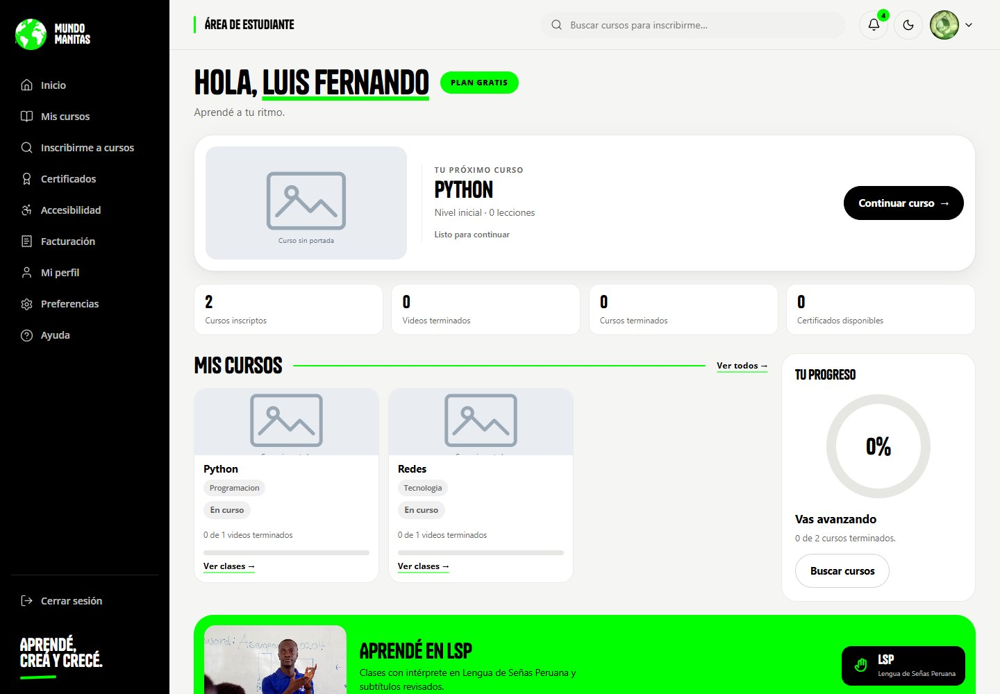
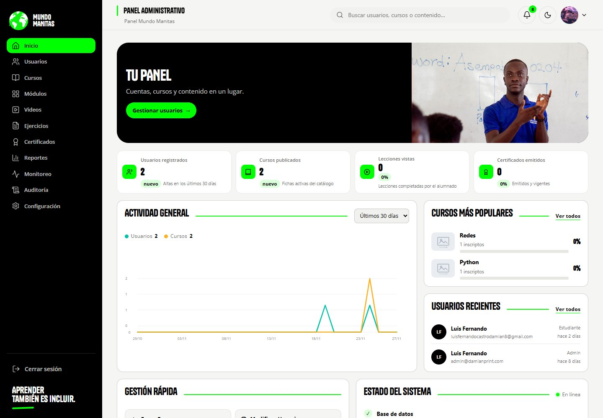
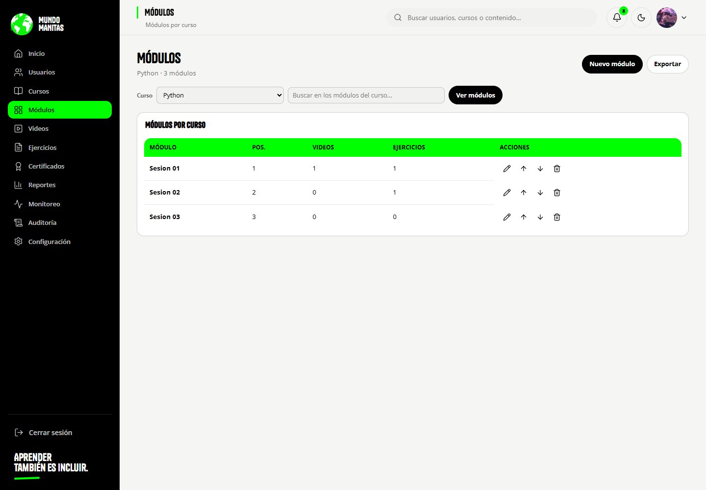
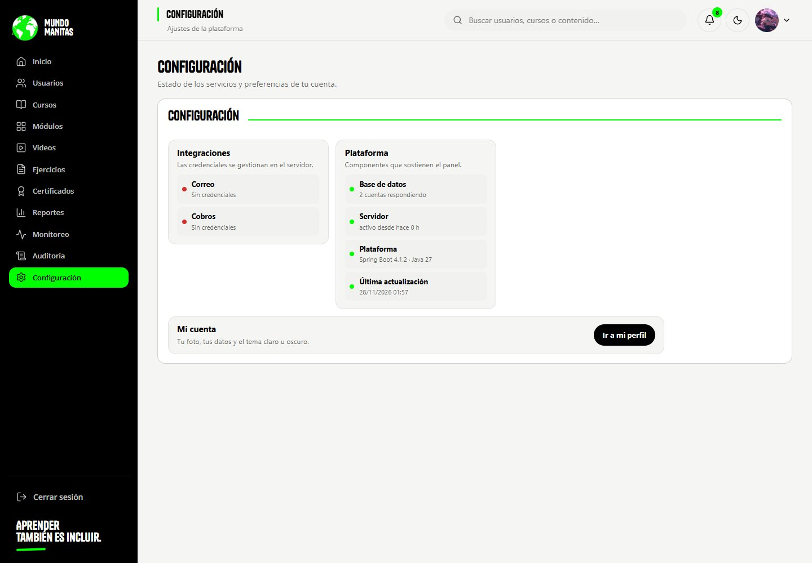
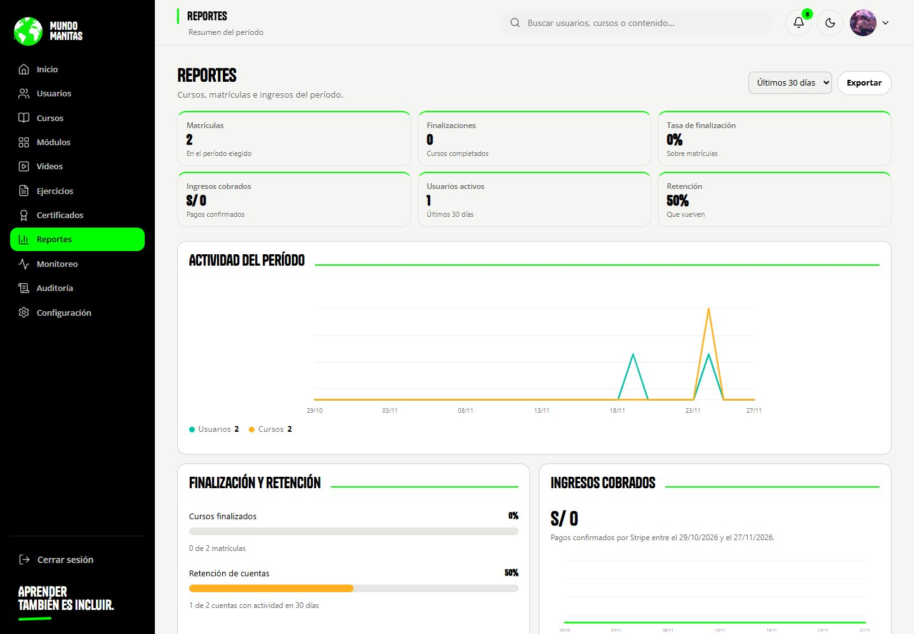
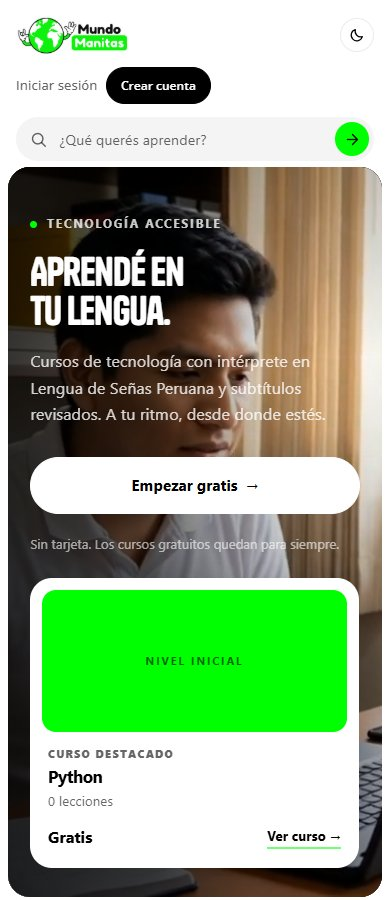
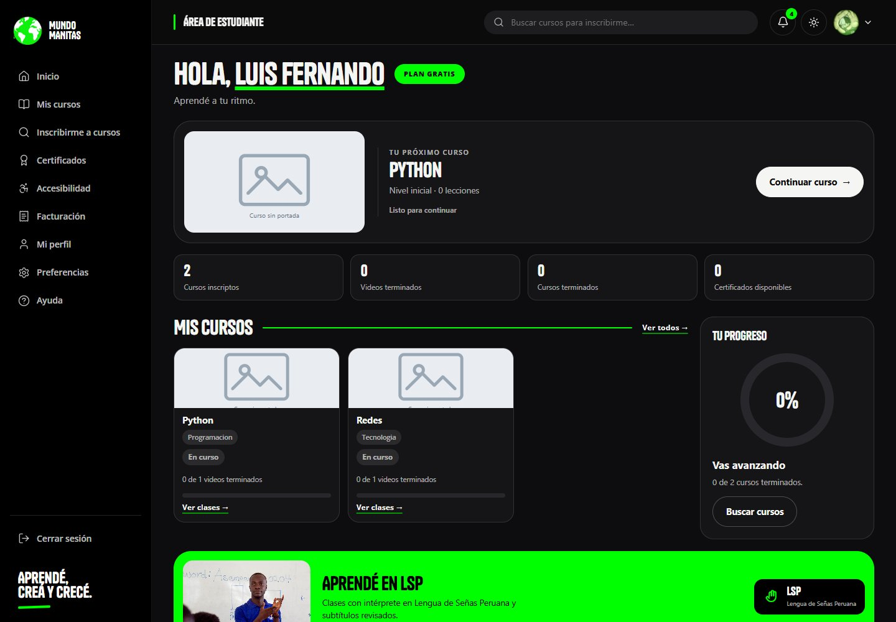

<div align="center">


### Cursos de tecnología en Lengua de Señas Peruana

Aprendé a tu ritmo, con intérprete y subtítulos en cada clase.

<br>


</div>

---

## Qué es

Mundo Manitas es una plataforma de cursos de tecnología pensada para personas
sordas usuarias de Lengua de Señas Peruana (LSP). Cada curso combina video,
intérprete en LSP y subtítulos revisados para que el contenido se entienda sin
depender del audio.

El repositorio es el sitio completo: portada, catálogo, fichas de curso, páginas
legales, cuentas reales, panel del estudiante, panel administrativo y el diseño
documentado. Es una aplicación **monolítica** con Spring Boot que genera el HTML
en el servidor; no hay frontend aparte.

## Qué incluye

- **Portada** con video, curso destacado y acciones que abren el modal de cuenta.
- **Catálogo** de cursos reales de PostgreSQL, con búsqueda y filtros por área.
- **Cuentas** con registro, acceso, cierre de sesión, BCrypt, CSRF y
  remember-me de 14 días.
- **Panel del estudiante** con sus cursos, avance por ítem, certificados y datos
  de la cuenta.
- **Panel administrativo** con usuarios, cursos, módulos por curso, videos,
  ejercicios, certificados, reportes, monitoreo, auditoría y configuración.
- **Temario estructurado**: módulos, secciones e ítems (`VIDEO`, `VIDEO_LSP`,
  `MATERIAL` y `EJERCICIO`), sílabo y recursos descargables.
- **Membresías** con checkout de Stripe y webhook de confirmación.
- **Correos** de bienvenida y restablecimiento de contraseña con Resend.
- **Accesibilidad**: teclado, foco visible, movimiento reducido y contraste AA.

## Membresías

Crear la cuenta es gratis y sin tarjeta; el cobro de la membresía se habilita
dentro de la cuenta. Cada tarjeta separa lo que **incluye** de lo que **no
incluye**.

| Plan | Costo | Qué incluye |
|---|---|---|
| **Gratis** | Sin costo | Cursos gratuitos, intérprete en LSP, subtítulos revisados y progreso guardado |
| **Mensual** | S/ 29 al mes | Todo el catálogo, certificado por curso, cursos nuevos y cancelación libre |
| **Anual** | S/ 290 al año | Todo lo del mensual, 12 meses continuos y precio fijo (equivale a S/ 24,17 al mes) |

El plan anual es el destacado: se pagan diez meses y se usan doce. Los tres
botones abren el modal de registro sobre la misma página.


## Paneles

### Estudiante

Al iniciar sesión se entra directo a `/panel`. Reúne el próximo curso, los cursos
disponibles, el progreso, los certificados y los datos de la cuenta. A los cursos
se entra por `/panel/cursos` y el temario guarda el avance ítem por ítem.



### Administrativo

`/admin` es el inicio del panel y muestra KPIs, actividad, cursos populares,
usuarios recientes, gestión rápida y estado del sistema. La barra lateral lleva a
usuarios, cursos, módulos, videos, ejercicios, certificados, reportes, monitoreo,
auditoría y configuración.

En **Módulos** primero se elige un curso y después se listan solo sus módulos,
con su posición y las acciones de ordenar, editar o eliminar. En el temario de
cada curso se cargan secciones, ítems, sílabo y recursos, y se publica o
despublica el contenido.

**Monitoreo** es una consola operativa con reloj en vivo, sondeo cada 2 segundos,
CPU y memoria reales del proceso, KPIs con tendencia, tráfico, latencias
p50/p95/p99, mapa de calor por minuto, respuestas recientes, rutas calientes,
caídas con su `requestId` y actividad de PostgreSQL. La vista consulta
`/admin/api/monitoreo`; el JSON sale del buffer de peticiones del servidor, no de
un `fetch` a Actuator desde el navegador.



| Módulos por curso | Configuración |
|---|---|
|  |  |



## Capturas


<p align="center">
  
  
</p>

## Stack

| Pieza | Tecnología |
|---|---|
| Lenguaje | Java 25 |
| Framework | Spring Boot 4.1.2 (MVC + Security + Validation) |
| Vistas | Thymeleaf, HTML, CSS y JavaScript sin frameworks |
| Base de datos | PostgreSQL 18 |
| Migraciones | Flyway (`ddl-auto: validate`) |
| Build | Maven con wrapper incluido |
| Pruebas | JUnit 5 + AssertJ + Mockito (335 pruebas) |
| Métricas | Spring Boot Actuator + Micrometer/Prometheus |
| Iconos | Lucide local en `static/vendor/` |

## Requisitos

| Herramienta | Versión | Cómo verificar |
|---|---|---|
| JDK | 25 | `java -version` |
| PostgreSQL | 18 | `Get-Service postgresql-x64-18` |
| Maven | no hace falta | se usa `.\mvnw.cmd` |

Si tu `java` por defecto es otro:

```powershell
$env:JAVA_HOME = "C:\Program Files\Java\jdk-25.0.5.0.2"
$env:Path = "$env:JAVA_HOME\bin;$env:Path"
```

En IntelliJ: `File > Project Structure > Project` → SDK **25**, Language level **25**.

## Base de datos

La base se crea una sola vez; las tablas las crea Flyway al arrancar.

```powershell
& 'C:\Program Files\PostgreSQL\18\bin\psql.exe' -U postgres -h localhost -c "CREATE USER mundo_manitas WITH PASSWORD 'mundo_manitas';"
& 'C:\Program Files\PostgreSQL\18\bin\psql.exe' -U postgres -h localhost -c "CREATE DATABASE mundo_manitas_api OWNER mundo_manitas;"
```

| Dato | Valor por defecto |
|---|---|
| Host y puerto | `localhost:5432` |
| Base | `mundo_manitas_api` |
| Usuario | `mundo_manitas` |
| Contraseña | `mundo_manitas` |

Variables de entorno disponibles: `DATABASE_URL`, `DB_USER`, `DB_PASSWORD` y
`REMEMBER_ME_KEY`.

Con `ADMIN_PASSWORD` (y opcionalmente `ADMIN_EMAIL`) la app crea al arrancar la
cuenta ADMIN si no existe; si ya existe con otro rol la promueve, sin cambiarle
la clave. Sin esa variable no se crea ni se modifica ninguna cuenta.

Las migraciones van de `V1__accounts.sql` a
`V17__marcado_ejercicios_y_lsp.sql`: cuentas, recuperación, cursos e
inscripciones, módulos de cuenta, administración, videos privados, progreso,
publicación, estructura de contenido (módulos, secciones, ítems y sílabo),
documentos descargables, cuestionarios de ejercicios, marcado configurable del
ejercicio e identificador LSP de la cuenta. `V14` no borra las tablas anteriores:
crea `content_items` con `source_type`/`source_id` y los triggers que conservan
videos, ejercicios y progreso ya cargados. Una migración ya ejecutada **no se
edita** (Flyway guarda su checksum); el cambio va en una migración posterior.

### Backup y restauración

Los scripts están en `scripts/` y trabajan con `pg_dump`/`pg_restore` en formato
custom. La contraseña se pasa por `DB_PASSWORD`, nunca se guarda en el repo.

```powershell
$env:DB_PASSWORD = 'valor-secreto'
.\scripts\backup-db.ps1 -BackupDir .\backups   # genera .dump y .sha256
.\scripts\restore-db.ps1 -BackupFile .\backups\mundomanitas_....dump -ConfirmRestore
.\scripts\test-backup-restore.ps1              # prueba real en un schema temporario
```

Los backups se conservan 14 días; la restauración exige `-ConfirmRestore` y
verifica el checksum antes de tocar la base. El detalle está en
[`docs/plan-de-backups.md`](docs/plan-de-backups.md).

## Arrancar

```powershell
.\mvnw.cmd spring-boot:run
```

| URL | Qué es |
|---|---|
| http://localhost:8080 | Sitio |
| http://localhost:8080/admin | Panel administrativo (requiere `ROLE_ADMIN`) |
| http://localhost:8080/actuator/health | Estado de la app y de los pagos (protegido) |

Compilar, probar y ejecutar el JAR:

```powershell
.\mvnw.cmd clean package      # jar en target\api-0.0.1-SNAPSHOT.jar
.\mvnw.cmd test               # 335 pruebas
java -jar target\api-0.0.1-SNAPSHOT.jar
```

## Rutas

| Ruta | Qué muestra |
|---|---|
| `/` | Portada con el curso destacado |
| `/cursos` | Catálogo con búsqueda y filtros por área |
| `/buscar?q=` | Resultados de búsqueda sobre el catálogo |
| `/cursos/{slug}` | Ficha del curso, "Qué incluye" y cursos relacionados |
| `/nosotros` | El proyecto, la misión y el equipo |
| `/panel` | Panel del estudiante (requiere sesión) |
| `/panel/cursos` · `/panel/cursos/{slug}` | Mis cursos y temario del curso |
| `/panel/cursos/{slug}/items/{itemId}/visto` | Solo POST: guarda el avance de un ítem |
| `/panel/certificados` · `/panel/certificados/{slug}` | Certificados obtenidos y descarga |
| `/admin` | Inicio del panel administrativo (`ROLE_ADMIN`) |
| `/admin/cursos/{id}/contenido` | Temario, sílabo y recursos del curso |
| `/admin/modulos?curso={id}` | Módulos de un curso, en orden |
| `/admin/reportes` · `/admin/monitoreo` · `/admin/auditoria` | Reportes, consola operativa y registro |
| `/admin/configuracion` · `/admin/perfil` | Ajustes de la plataforma y cuenta |
| `/terminos` · `/privacidad` | Términos de uso y política de privacidad |
| `/login` | Solo POST: procesa el acceso; la vista es el modal en `/?login` |
| `/registro` | Alta de cuenta (página completa) |
| `/recuperar` · `/restablecer?token=` | Pedir el enlace y elegir la contraseña nueva |
| `/logout` | Cierre de sesión (POST con token CSRF) |
| `/actuator/health` | Estado de la app y de los pagos (protegido) |
| `/actuator/info` · `/actuator/metrics` · `/actuator/prometheus` | Métricas (protegido) |

Las páginas cargan el modal de cuenta como fragmento. Los botones "Iniciar
sesión", "Crear cuenta", "Empezar gratis" y similares llevan `data-auth-open` y
abren el modal sobre la página, sin recargar. No existe página de login:
`GET /login` vuelve a la portada y `/login` solo atiende el POST. `/registro`
sigue siendo una página completa.

Al iniciar sesión —o al terminar el registro, que deja la sesión abierta— se
entra directo al panel según el rol. Si la sesión no existe, `/panel` y `/admin`
redirigen a `/?login`.

## Estructura

```
api/
├── pom.xml                          dependencias
├── mvnw / mvnw.cmd                  Maven
├── docs/
│   ├── design-system.md             contrato visual, tokens y reglas de detalle
│   ├── git-conventions.md           ramas y mensajes de commit
│   ├── guia-administrador-contenido.md  cómo cargar temario, sílabo y recursos
│   ├── plan-de-backups.md           respaldo y restauración de la base
│   ├── plan-de-monitoreo.md         consola operativa y métricas
│   ├── seguridad-y-rate-limiting.md límites de intentos y cabeceras
│   └── img/                         logo y capturas del README
└── src/
    ├── main/
    │   ├── java/com/mundomanitas/api/
    │   │   ├── ApiApplication.java  arranca la aplicación
    │   │   ├── config/              seguridad, beans y arranque del admin
    │   │   ├── controller/          URLs del sitio y del panel
    │   │   ├── dto/                 datos entre capas y vistas
    │   │   ├── exception/           errores propios
    │   │   ├── model/               entidades JPA
    │   │   ├── repository/          consultas a la base
    │   │   ├── security/            usuario autenticado
    │   │   └── service/             reglas de negocio (incluye admin)
    │   └── resources/
    │       ├── application.yml      configuración
    │       ├── db/migration/        SQL versionado (Flyway)
    │       ├── static/              css, js, fuentes, imágenes y vendor
    │       └── templates/
    │           ├── fragments/       cabecera, pie, modal de cuenta e iconos
    │           ├── auth/            registro y recuperación
    │           ├── cursos/          catálogo y detalle
    │           ├── admin/           panel de administración y contenido
    │           ├── student/         panel del estudiante
    │           └── legal/           términos y privacidad
    └── test/java/com/mundomanitas/api/  pruebas
```

La regla de dependencias es `controller → service → repository`, con `model`
debajo. El controlador no consulta el repositorio, el repositorio no tiene reglas
y las entidades no llegan a las vistas: se convierten en `dto`.

## Cuentas y seguridad

- Contraseñas con **BCrypt**; nunca se guarda el texto plano.
- Correo único sin distinguir mayúsculas (`unique index lower(email)`).
- Sesión administrada por Spring Security y remember-me de 14 días.
- **CSRF** activo en todos los formularios, incluido el modal.
- Cabeceras `Referrer-Policy` y `Permissions-Policy`; cookie de sesión
  `HttpOnly` con `SameSite=Lax`.
- Validación en el servidor con Bean Validation y errores por campo.
- Límite de intentos por IP en formularios sensibles (`429` con `Retry-After`);
  el detalle está en
  [`docs/seguridad-y-rate-limiting.md`](docs/seguridad-y-rate-limiting.md).
- El modal envía con `fetch`; sin JavaScript, el mismo formulario funciona como
  POST normal y vuelve a la página con el error.

## Correos y recuperación de contraseña

Los correos salen con **Resend** por su API REST, no por SMTP. Se envían dos:
bienvenida al crear la cuenta y enlace para restablecer la contraseña.

```powershell
$env:RESEND_API_KEY = "re_..."
$env:MAIL_FROM = "Mundo Manitas <hola@tudominio.com>"
$env:APP_BASE_URL = "https://mundomanitas.com"
$env:RESET_MINUTES = "60"
```

| Variable | Para qué | Valor por defecto |
|---|---|---|
| `RESEND_API_KEY` | Clave de Resend | vacía: el correo se omite |
| `MAIL_FROM` | Remitente verificado en Resend | `onboarding@resend.dev` |
| `APP_BASE_URL` | Dominio de los enlaces de los correos | `http://localhost:8080` |
| `RESEND_ENDPOINT` | Raíz de la API (pruebas) | `https://api.resend.com` |
| `RESET_MINUTES` | Vigencia del enlace | `60` |

Sin clave, el registro y el resto del sitio funcionan: el envío se anota en el
log y se omite.

Reglas del restablecimiento:

- El token viaja solo en el correo; en la base queda su **hash SHA-256**.
- Sirve **una vez**, vence a los 60 minutos y el pedido nuevo borra los anteriores.
- La pantalla de `/recuperar` responde igual exista o no la cuenta.
- Al guardar la contraseña se quema el token y se vuelve al inicio con el modal
  en `/?login&reset`.
- La migración es `V2__password_reset.sql`.

## Diseño y accesibilidad

La identidad es **verde `#00FF00`, blanco y negro**, con Tanker en los titulares,
Open Sans en la navegación y el pie, y la tipografía del sistema en el cuerpo. El
contrato completo, los tokens y las reglas de detalle están en
[`docs/design-system.md`](docs/design-system.md).

El sitio respeta `prefers-color-scheme` y el botón de la cabecera alterna claro y
oscuro; la elección queda en `localStorage` y se fija antes de pintar para evitar
el destello blanco. El mismo interruptor funciona en la portada, las páginas
internas y los paneles.

| Claro | Oscuro |
|---|---|
|  |  |
|  |  |

El piso de calidad que se revisa en cada pantalla nueva:

- Enlace "Saltar al contenido" y `:focus-visible` visible en todo.
- Contraste AA: 4.5:1 en texto normal, 3:1 en texto grande y placeholders.
- Todo operable con teclado; los modales atrapan el foco y lo devuelven al cerrar.
- `prefers-reduced-motion` apaga animaciones y realces.
- Hover solo con puntero fino; en táctil no quedan estados pegados.
- Sin rótulos sobre los titulares y sin saltos de nivel en los encabezados.

## Pruebas

```powershell
.\mvnw.cmd test
```

| Prueba | Qué cubre |
|---|---|
| `ApiApplicationTests` | El contexto arranca con la base y las migraciones |
| `CursoCatalogTest` | Búsqueda, filtros, slugs y fichas del catálogo |
| `AuthServiceTest`, `ActualUsuarioServiceTest` | Registro y usuario de la sesión |
| `LeccionProgresoServiceTest`, `InscripcionServiceTest`, `CertificadoEmisorServiceTest` | Progreso, matrículas y certificados |
| `PagoServiceTest`, `PagoHealthIndicatorTest` | Checkout, webhook, confirmación y estado de la pasarela |
| `AdminCatalogServiceTest`, `AdminMethodSecurityTest` | CRUD admin y exigencia de `ROLE_ADMIN` |
| `SecurityAccessTest`, `DatosExposureAndRateLimitTest` | Roles, CSRF, cabeceras, cookie `SameSite`, Actuator y límite por IP |
| `InputValidationTest` | Bean Validation, enlaces `https`/YouTube, escape de markup y errores sin 500 |
| `SoftwareFlujoTest` | Componentes, integración y autenticación de un flujo real |
| `CursoContenidoServiceTest`, `CursoContenidoBaseTest` | Temario, edición, orden, borrado, sílabo y progreso |
| `AdminCursoEstructuraFlujoTest`, `AdminContenidoPlantillaTest` | Rutas del panel de contenido y render con datos reales |
| `AdminPanelFlujoTest`, `AdminDesignVistaTest`, `AdminDeleteConfirmationTest` | Listados, diseño, módulos por curso y modales de borrado |
| `AdminPerfilVistaTest`, `AdminSesionPdfVistaTest` | Perfil del admin y temario sin enlace PDF |
| `AccesibilidadVistaTest`, `PanelDialogsRenderTest` | Avisos `aria-live`, foco, ayuda y errores enlazados |
| `EstudianteContenidoFlujoTest`, `EstudianteDashboardVistaTest`, `EstudianteCursoVistaTest` | Panel del alumno, avance real y render contra la matrícula |
| `DashboardPerformanceTest` | Avance del panel en consultas constantes, medido con Hibernate |
| `EstudianteCertificadoServiceTest`, `EstudianteCertificadoVistaTest` | Certificados vigentes, código emitido y revocaciones |
| `AdminCertificadoVistapreviaServiceTest`, `CertificadoPlantillaTest` | Vista previa admin y documento compartido con el alumno |
| `ContrasenaRestablecerServiceTest` | Hash del token, vencimiento, un solo uso y correo |
| `RequestIdFilterTest`, `MonitorServiceTest`, `MonitorRequestFilterTest` | `X-Request-Id`, series reales, latencias y caídas |
| `ActuatorSecurityTest`, `BusinessMetricsTest` | Acceso a Actuator y contadores `mundomanitas_*` |

Resultado actual: **335 de 335 en verde**. El detalle de monitoreo está en
[`docs/plan-de-monitoreo.md`](docs/plan-de-monitoreo.md).

## Estado

Funciona hoy: portada con video, catálogo real con búsqueda y filtros, fichas de
curso, páginas de nosotros, términos y privacidad, cuentas con sesión,
remember-me y cierre de sesión, membresías con checkout y webhook de Stripe,
panel del estudiante con inscripción, temario de módulos, secciones e ítems,
avance por clase y certificados, panel administrativo con alta, edición, orden y
borrado de contenido, módulos filtrados por curso, sílabo y recursos, reportes,
monitoreo, auditoría, configuración, modo claro/oscuro y correos con Resend.

El contenido se arma en `/admin/cursos/{id}/contenido` y se ve en
`/panel/cursos/{slug}` sin datos de ejemplo: los videos salen de YouTube sin
cookies, los materiales son enlaces `https` y los ejercicios muestran su
consigna. Al hacer clic en una sesión del temario se abre su video a la
izquierda. El registro pregunta si la persona usa LSP; esas cuentas ven solo los
ítems `VIDEO_LSP` cargados desde el panel admin. Los ejercicios se marcan como
vistos con 20/20; con menor puntaje se puede volver a rendir, y el admin puede
pasar el marcado a manual desde `/admin/ejercicios`. La guía de carga está en
[`docs/guia-administrador-contenido.md`](docs/guia-administrador-contenido.md).

Falta: intérprete en LSP y subtítulos propios sincronizados dentro del
reproductor; los videos en señas son ítems independientes y la velocidad y el
tamaño de subtítulos son preferencias guardadas, pero YouTube controla su
presentación.

## Para contribuir

1. Leé [`docs/git-conventions.md`](docs/git-conventions.md).
2. Trabajá en una rama `feature/...` o `fix/...`; `main` queda siempre estable.
3. Antes de abrir el merge: `.\mvnw.cmd test` y una mirada al render en 1440 px y
   390 px.
4. Los textos visibles van en español; clases, métodos y nombres de código, en
   inglés.

---

<div align="center">

**Mundo Manitas** · [hola@mundomanitas.com](mailto:hola@mundomanitas.com)

</div>
