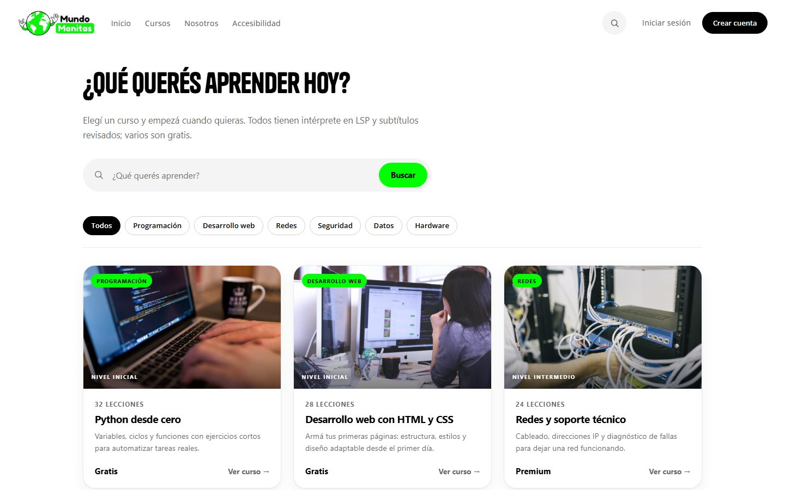

<div align="center">


### Cursos de tecnología en Lengua de Señas Peruana

Aprendé a tu ritmo, con intérprete y subtítulos en cada clase.

<br>


</div>

---

## Qué es

Mundo Manitas es una plataforma de cursos de tecnología pensada para personas
sordas usuarias de Lengua de Señas Peruana (LSP). Cada curso combina video,
intérprete en LSP y subtítulos revisados, para que el contenido se entienda sin
depender del audio.

El repositorio es el sitio completo: portada, catálogo, fichas de curso, páginas
legales, cuentas reales y el diseño documentado. Es una aplicación **monolítica**
con Spring Boot que genera el HTML en el servidor; no hay frontend aparte ni API
pública todavía.

- **Portada** con video, curso destacado y llamadas a la acción que abren el
  modal de cuenta.
- **Catálogo** de seis cursos con búsqueda por texto y filtros por área.
- **Cuentas** con registro, inicio y cierre de sesión, BCrypt y CSRF.
- **Membresías**: tres planes (gratis, mensual y anual) con lo que incluye cada uno.
- **Legal**: términos y privacidad con índice lateral.
- **Accesibilidad**: teclado, foco visible, movimiento reducido y contraste AA.

## Membresías

La portada presenta tres planes. Crear la cuenta es gratis y sin tarjeta; el
cobro de la membresía se habilita dentro de la cuenta.

| Plan | Precio | Qué incluye |
|---|---|---|
| **Gratis** | S/ 0 para siempre | 2 cursos abiertos, intérprete en LSP y subtítulos revisados, progreso guardado |
| **Mensual** | S/ 29 al mes | Los 6 cursos del catálogo, certificado por curso, cursos nuevos, cancelación libre |
| **Anual** | S/ 290 al año | Todo lo del mensual, 12 meses continuos y precio fijo (equivale a S/ 24,17 al mes) |

El plan anual es el destacado: se pagan diez meses y se usan doce. Los tres
botones abren el modal de registro sobre la misma página.

## Capturas





<p align="center">
  
</p>

---

## Stack

| Pieza | Tecnología |
|---|---|
| Lenguaje | Java 25 |
| Framework | Spring Boot 4.1.2 (MVC + Security + Validation) |
| Vistas | Thymeleaf, HTML, CSS y JavaScript sin frameworks |
| Base de datos | PostgreSQL 18 |
| Migraciones | Flyway (`ddl-auto: validate`) |
| Build | Maven con wrapper incluido |
| Pruebas | JUnit 5 + AssertJ (10 pruebas) |

## Requisitos

| Herramienta | Versión | Cómo verificar |
|---|---|---|
| JDK | 25 | `java -version` |
| PostgreSQL | 18 | `Get-Service postgresql-x64-18` |
| Maven | no hace falta | se usa `.\mvnw.cmd` |

Si tu `java` por defecto es otro:

```powershell
$env:JAVA_HOME = "C:\Program Files\Java\jdk-25.0.5.0.2"
$env:Path = "$env:JAVA_HOME\bin;$env:Path"
```

En IntelliJ: `File > Project Structure > Project` → SDK **25**, Language level **25**.

## Base de datos

La base se crea una sola vez; las tablas las crea Flyway al arrancar.

```powershell
& 'C:\Program Files\PostgreSQL\18\bin\psql.exe' -U postgres -h localhost -c "CREATE USER mundo_manitas WITH PASSWORD 'mundo_manitas';"
& 'C:\Program Files\PostgreSQL\18\bin\psql.exe' -U postgres -h localhost -c "CREATE DATABASE mundo_manitas_api OWNER mundo_manitas;"
```

| Dato | Valor por defecto |
|---|---|
| Host y puerto | `localhost:5432` |
| Base | `mundo_manitas_api` |
| Usuario | `mundo_manitas` |
| Contraseña | `mundo_manitas` |

Se pueden pisar con variables de entorno: `DATABASE_URL`, `DB_USER`,
`DB_PASSWORD` y `REMEMBER_ME_KEY`.

La migración vigente es `V1__accounts.sql`: usuarios, roles, preferencias de
accesibilidad y el trigger de `updated_at`. Una migración ya ejecutada **no se
edita** (Flyway guarda su checksum); el cambio va en la versión siguiente.

## Arrancar

```powershell
.\mvnw.cmd spring-boot:run
```

| URL | Qué es |
|---|---|
| http://localhost:8080 | Sitio |
| http://localhost:8080/actuator/health | Estado de la app y de la base |

Compilar y probar:

```powershell
.\mvnw.cmd clean package      # jar en target\api-0.0.1-SNAPSHOT.jar
.\mvnw.cmd test               # 10 pruebas
java -jar target\api-0.0.1-SNAPSHOT.jar
```

## Rutas

| Ruta | Qué muestra |
|---|---|
| `/` | Portada con el curso destacado |
| `/cursos` | Catálogo con búsqueda y filtros por área |
| `/buscar?q=` | Resultados de búsqueda sobre el catálogo |
| `/cursos/{slug}` | Ficha del curso, "Qué incluye" y cursos relacionados |
| `/nosotros` | El proyecto, la misión y el equipo |
| `/terminos` | Términos de uso |
| `/privacidad` | Política de privacidad |
| `/login` | Inicio de sesión (página completa) |
| `/registro` | Alta de cuenta (página completa) |
| `/logout` | Cierre de sesión (POST con token CSRF) |
| `/actuator/health` · `/actuator/info` | Estado de la aplicación |

Las páginas del sitio cargan el modal de cuenta como fragmento. Los botones
"Iniciar sesión", "Crear cuenta", "Empezar gratis", "Crear mi cuenta" y "Crear
cuenta gratis" llevan `data-auth-open` y abren el modal sobre la página con el
fondo difuminado, sin recargar. `/login` y `/registro` siguen funcionando como
páginas completas: si el JavaScript no corre, los enlaces llevan ahí.

## Estructura

```
api/
├── pom.xml                          dependencias
├── mvnw / mvnw.cmd                  Maven
├── skills-lock.json                 skills del agente, fijadas por commit
├── docs/
│   ├── design-system.md             contrato visual y reglas de detalle
│   ├── git-conventions.md           ramas y mensajes de commit
│   └── img/                         logo y capturas del README
└── src/
    ├── main/
    │   ├── java/com/mundomanitas/api/
    │   │   ├── ApiApplication.java      arranca la aplicación
    │   │   ├── config/                  Spring Security y beans
    │   │   ├── controller/              URLs del sitio
    │   │   ├── dto/                     datos entre capas y vistas
    │   │   ├── exception/               errores propios
    │   │   ├── model/                   entidades JPA
    │   │   ├── repository/              consultas a la base
    │   │   ├── security/                usuario autenticado
    │   │   └── service/                 reglas de negocio
    │   └── resources/
    │       ├── application.yml          configuración
    │       ├── db/migration/            SQL versionado (Flyway)
    │       ├── static/                  css, js, fuentes, imágenes y video
    │       └── templates/
    │           ├── fragments/           cabecera, pie y modal de cuenta
    │           ├── auth/                login y registro
    │           ├── cursos/              catálogo y detalle
    │           ├── legal/               términos y privacidad
    │           └── error/               páginas de error
    └── test/java/com/mundomanitas/api/  pruebas
```

La regla de dependencias es `controller → service → repository`, con `model`
debajo. El controlador no consulta el repositorio, el repositorio no tiene reglas
y las entidades no llegan a las vistas: se convierten en `dto`.

## Cuentas y seguridad

- Contraseñas con **BCrypt**; nunca se guarda el texto plano.
- Correo único sin distinguir mayúsculas (`unique index lower(email)`).
- Sesión administrada por Spring Security y **remember-me** de 14 días.
- **CSRF** activo en todos los formularios, incluido el modal.
- Validación en el servidor con Bean Validation y errores por campo.
- El modal envía con `fetch`; si el navegador no ejecuta JavaScript, el mismo
  formulario funciona como POST normal y vuelve a la página con el error.

## Diseño y accesibilidad

La identidad es **verde `#00FF00`, blanco y negro**, con Tanker en los titulares,
Open Sans en la navegación y el pie, y la tipografía del sistema en el cuerpo. El
contrato completo, los tokens y las reglas de detalle están en
[`docs/design-system.md`](docs/design-system.md).

El piso de calidad que se revisa en cada pantalla nueva:

- Enlace "Saltar al contenido" y `:focus-visible` visible en todo.
- Contraste AA: 4.5:1 en texto normal, 3:1 en texto grande y placeholders.
- Todo operable con teclado; el modal atrapa el foco y lo devuelve al cerrar.
- `prefers-reduced-motion` apaga animaciones y realces.
- Hover solo con puntero fino; en táctil no quedan estados pegados.
- Sin rótulos sobre los titulares y sin saltos de nivel en los encabezados.

## Pruebas

```powershell
.\mvnw.cmd test
```

| Prueba | Qué cubre |
|---|---|
| `ApiApplicationTests` | El contexto de Spring arranca con la base y las migraciones |
| `CourseCatalogTest` | Búsqueda, filtros, slugs y fichas del catálogo (9 casos) |

Resultado actual: **10 de 10 en verde**.

## Estado

Funciona hoy: portada con video, catálogo de seis cursos con búsqueda y filtros,
fichas de curso, páginas de nosotros, términos y privacidad, cuentas reales con
sesión, remember-me y cierre de sesión, y la sección de membresías con los tres
planes.

Falta: preferencias de accesibilidad editables, inscripción y lecciones,
reproductor con video en LSP y subtítulos, progreso, cobro real de la membresía y
panel de administración. El reparto de tareas está en
[`REGLAS-EQUIPO.txt`](REGLAS-EQUIPO.txt).

## Para contribuir

1. Leé [`REGLAS-EQUIPO.txt`](REGLAS-EQUIPO.txt) y
   [`docs/git-conventions.md`](docs/git-conventions.md).
2. Trabajá en una rama `feature/...` o `fix/...`; `main` queda siempre estable.
3. Antes de abrir el merge: `.\mvnw.cmd test` y una mirada al render en 1440 px y
   390 px.
4. Los textos visibles van en español; clases, métodos y nombres de código, en
   inglés.

---

<div align="center">

**Mundo Manitas** · [hola@mundomanitas.com](mailto:hola@mundomanitas.com)

</div>
