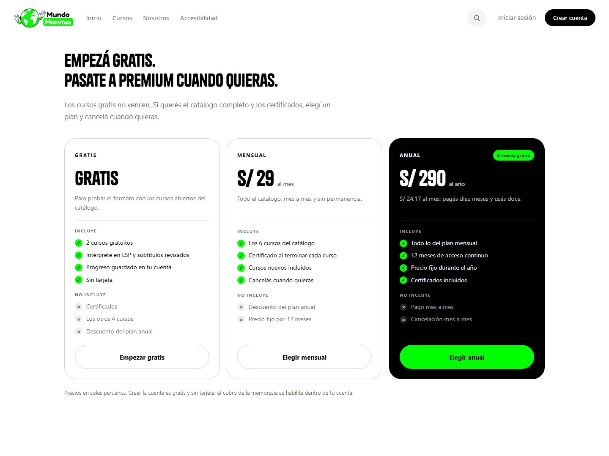
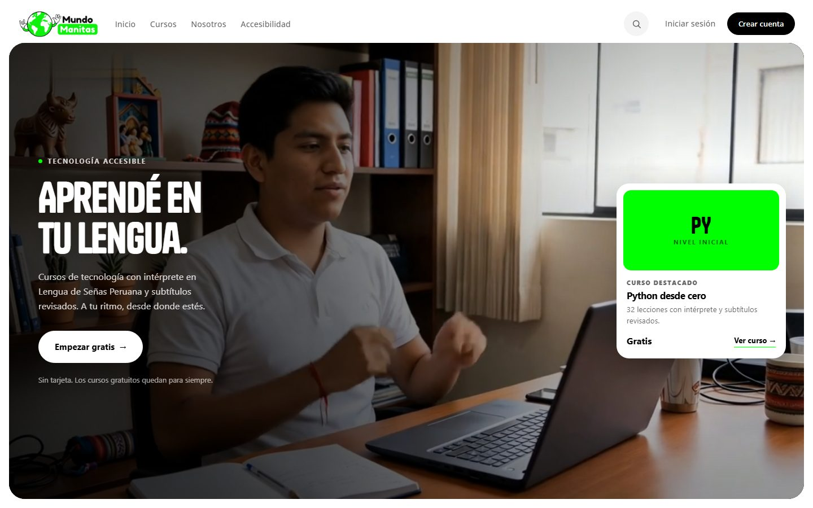
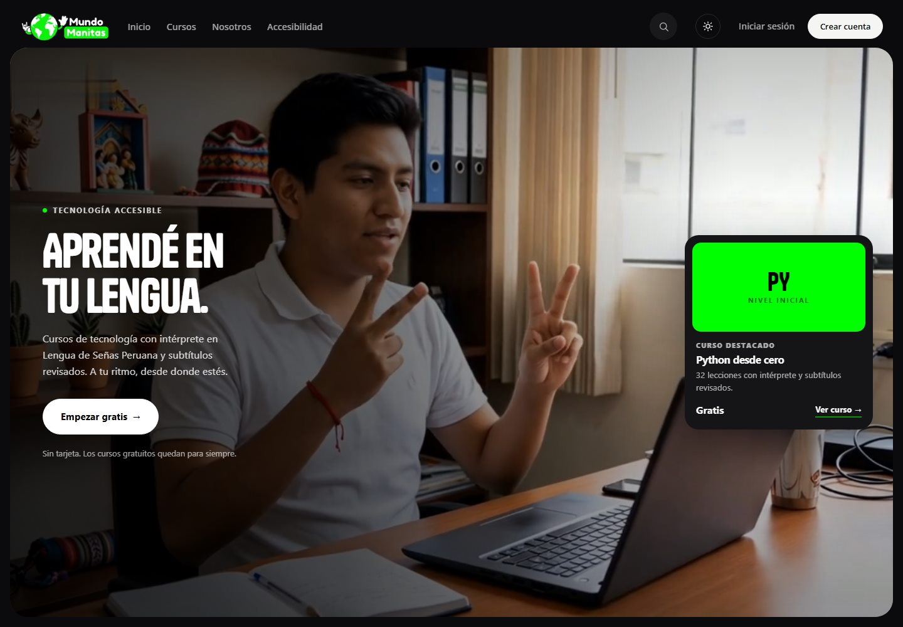
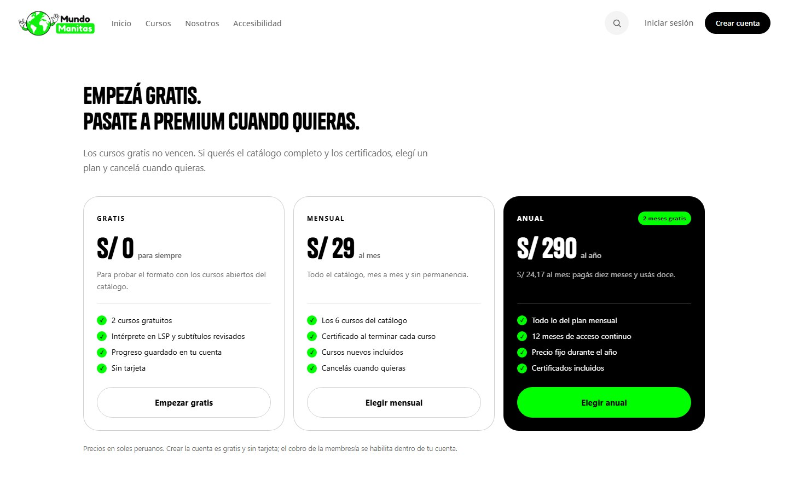
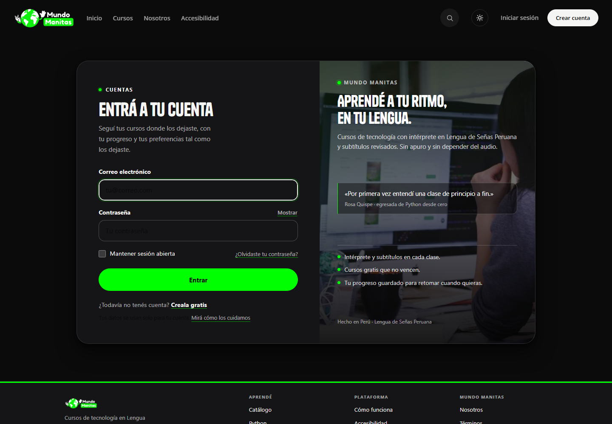
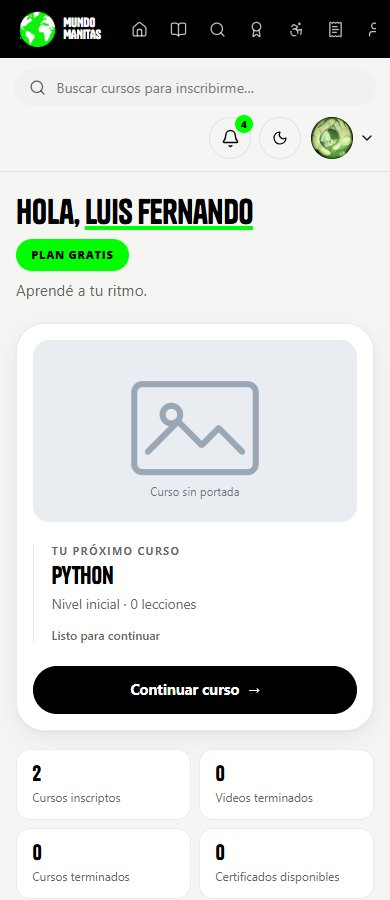

<div align="center">


### Cursos de tecnología en Lengua de Señas Peruana

Aprendé a tu ritmo, con intérprete y subtítulos en cada clase.

<br>


</div>

---

## Qué es

Mundo Manitas es una plataforma de cursos de tecnología pensada para personas
sordas usuarias de Lengua de Señas Peruana (LSP). Cada curso combina video,
intérprete en LSP y subtítulos revisados, para que el contenido se entienda sin
depender del audio.

El repositorio es el sitio completo: portada, catálogo, fichas de curso, páginas
legales, cuentas reales y el diseño documentado. Es una aplicación **monolítica**
con Spring Boot que genera el HTML en el servidor; no hay frontend aparte ni API
pública todavía.

- **Portada** con video, curso destacado y llamadas a la acción que abren el
  modal de cuenta.
- **Catálogo** de cursos reales de PostgreSQL con búsqueda por texto y filtros por área.
- **Cuentas** con registro, inicio y cierre de sesión, BCrypt y CSRF.
- **Panel del estudiante** con sus cursos, progreso y datos de la cuenta; al
  entrar, la sesión aterriza ahí.
- **Membresías**: tres planes (gratis, mensual y anual) con lo que incluye y lo
  que no incluye cada uno.
- **Legal**: términos y privacidad con índice lateral.
- **Accesibilidad**: teclado, foco visible, movimiento reducido y contraste AA.

## Membresías

La portada presenta tres planes. Crear la cuenta es gratis y sin tarjeta; el
cobro de la membresía se habilita dentro de la cuenta. Cada tarjeta separa lo
que **incluye** de lo que **no incluye**.

| Plan | Costo | Qué incluye |
|---|---|---|
| **Gratis** | Sin costo | Cursos gratuitos, intérprete en LSP y subtítulos revisados, progreso guardado |
| **Mensual** | S/ 29 al mes | Todo el catálogo, certificado por curso, cursos nuevos, cancelación libre |
| **Anual** | S/ 290 al año | Todo lo del mensual, 12 meses continuos y precio fijo (equivale a S/ 24,17 al mes) |

El plan anual es el destacado: se pagan diez meses y se usan doce. Los tres
botones abren el modal de registro sobre la misma página.



## Panel del estudiante

Al iniciar sesión se entra directo a `/panel`, sin volver a la portada. El panel
reúne el próximo curso, los cursos disponibles, el progreso, los certificados y
los datos de la cuenta. La barra lateral lleva a mis cursos, al catálogo, al
perfil y a la información de accesibilidad.


## Modo claro y oscuro

El sitio completo respeta `prefers-color-scheme` y el botón de la cabecera
permite alternar el tema. La elección queda guardada en el navegador y se
mantiene al navegar entre la portada, las páginas internas y el panel.

| Claro | Oscuro |
|---|---|
|  |  |
|  |  |

## Capturas






<p align="center">
  
  
</p>

---

## Stack

| Pieza | Tecnología |
|---|---|
| Lenguaje | Java 25 |
| Framework | Spring Boot 4.1.2 (MVC + Security + Validation) |
| Vistas | Thymeleaf, HTML, CSS y JavaScript sin frameworks |
| Base de datos | PostgreSQL 18 |
| Migraciones | Flyway (`ddl-auto: validate`) |
| Build | Maven con wrapper incluido |
| Pruebas | JUnit 5 + AssertJ + Mockito (209 pruebas) |
| Métricas | Spring Boot Actuator + Micrometer/Prometheus |

## Requisitos

| Herramienta | Versión | Cómo verificar |
|---|---|---|
| JDK | 25 | `java -version` |
| PostgreSQL | 18 | `Get-Service postgresql-x64-18` |
| Maven | no hace falta | se usa `.\mvnw.cmd` |

Si tu `java` por defecto es otro:

```powershell
$env:JAVA_HOME = "C:\Program Files\Java\jdk-25.0.5.0.2"
$env:Path = "$env:JAVA_HOME\bin;$env:Path"
```

En IntelliJ: `File > Project Structure > Project` → SDK **25**, Language level **25**.

## Base de datos

La base se crea una sola vez; las tablas las crea Flyway al arrancar.

```powershell
& 'C:\Program Files\PostgreSQL\18\bin\psql.exe' -U postgres -h localhost -c "CREATE USER mundo_manitas WITH PASSWORD 'mundo_manitas';"
& 'C:\Program Files\PostgreSQL\18\bin\psql.exe' -U postgres -h localhost -c "CREATE DATABASE mundo_manitas_api OWNER mundo_manitas;"
```

| Dato | Valor por defecto |
|---|---|
| Host y puerto | `localhost:5432` |
| Base | `mundo_manitas_api` |
| Usuario | `mundo_manitas` |
| Contraseña | `mundo_manitas` |

Se pueden pisar con variables de entorno: `DATABASE_URL`, `DB_USER`,
`DB_PASSWORD` y `REMEMBER_ME_KEY`.

Las migraciones van de `V1__accounts.sql` a
`V14__estructura_contenido.sql`: cuentas, recuperación, cursos e inscripciones,
módulos de cuenta, administración, videos privados, progreso, publicación y la
estructura de contenido (módulos, secciones, ítems y sílabo). `V14` no borra las
tablas anteriores: crea `content_items` con `source_type`/`source_id` y los
triggers que conservan videos, ejercicios y progreso ya cargados. Una migración
ya ejecutada **no se edita** (Flyway guarda su checksum); el cambio va en `V15`
o posterior.

### Backup y restauración

Los scripts están en `scripts/` y trabajan con `pg_dump`/`pg_restore` en formato
custom. La contraseña se pasa por `DB_PASSWORD`, nunca se guarda en el repo.

```powershell
$env:DB_PASSWORD = 'valor-secreto'
.\scripts\backup-db.ps1 -BackupDir .\backups   # genera .dump y .sha256
.\scripts\restore-db.ps1 -BackupFile .\backups\mundomanitas_....dump -ConfirmRestore
.\scripts\test-backup-restore.ps1              # prueba real en un schema temporario
```

Los backups se conservan 14 días y la restauración exige `-ConfirmRestore` y
verifica el checksum antes de tocar la base. El detalle está en
[`docs/plan-de-backups.md`](docs/plan-de-backups.md).

## Arrancar

```powershell
.\mvnw.cmd spring-boot:run
```

| URL | Qué es |
|---|---|
| http://localhost:8080 | Sitio |
| http://localhost:8080/actuator/health | Estado de la app, R2 y pagos (protegido) |

Compilar y probar:

```powershell
.\mvnw.cmd clean package      # jar en target\api-0.0.1-SNAPSHOT.jar
.\mvnw.cmd test               # 209 pruebas
java -jar target\api-0.0.1-SNAPSHOT.jar
```

## Rutas

| Ruta | Qué muestra |
|---|---|
| `/` | Portada con el curso destacado |
| `/cursos` | Catálogo con búsqueda y filtros por área |
| `/buscar?q=` | Resultados de búsqueda sobre el catálogo |
| `/cursos/{slug}` | Ficha del curso, "Qué incluye" y cursos relacionados |
| `/nosotros` | El proyecto, la misión y el equipo |
| `/panel` | Panel del estudiante (requiere sesión) |
| `/panel/cursos` · `/panel/cursos/{slug}` | Mis cursos y temario del curso (módulos, secciones e ítems) |
| `/panel/cursos/{slug}/items/{itemId}/visto` | Solo POST: guarda el avance de un ítem (token CSRF) |
| `/panel/certificados` · `/panel/certificados/{slug}` | Certificados obtenidos y descarga del curso |
| `/admin` | Panel administrativo (requiere `ROLE_ADMIN`) |
| `/admin/cursos/{id}/contenido` | Temario, sílabo y recursos del curso |
| `/terminos` | Términos de uso |
| `/privacidad` | Política de privacidad |
| `/login` | Solo POST: procesa el acceso; la vista es el modal en `/?login` |
| `/registro` | Alta de cuenta (página completa) |
| `/recuperar` | Pedir el enlace para restablecer la contraseña |
| `/restablecer?token=` | Elegir la contraseña nueva desde el enlace del correo |
| `/logout` | Cierre de sesión (POST con token CSRF) |
| `/actuator/health` | Estado de la app, R2 y pagos (protegido) |
| `/actuator/info` · `/actuator/metrics` · `/actuator/prometheus` | Métricas (protegido) |

Las páginas del sitio cargan el modal de cuenta como fragmento. Los botones
"Iniciar sesión", "Crear cuenta", "Empezar gratis", "Crear mi cuenta" y "Crear
cuenta gratis" llevan `data-auth-open` y abren el modal sobre la página con el
fondo difuminado, sin recargar. No existe página de login: `GET /login` vuelve a
la portada y `/login` solo atiende el POST de autenticación. `/registro` sigue
siendo una página completa.

Al iniciar sesión —o al terminar el registro, que deja la sesión abierta— se
entra directo al panel según el rol. Si la sesión no existe, `/panel` y
`/admin` redirigen a `/?login`.

## Estructura

```
api/
├── pom.xml                          dependencias
├── mvnw / mvnw.cmd                  Maven
├── skills-lock.json                 skills del agente, fijadas por commit
├── docs/
│   ├── design-system.md             contrato visual y reglas de detalle
│   ├── git-conventions.md           ramas y mensajes de commit
│   ├── guia-administrador-contenido.md  cómo cargar temario, sílabo y recursos
│   └── img/                         logo y capturas del README
└── src/
    ├── main/
    │   ├── java/com/mundomanitas/api/
    │   │   ├── ApiApplication.java      arranca la aplicación
    │   │   ├── config/                  Spring Security y beans
    │   │   ├── controller/              URLs del sitio
    │   │   ├── dto/                     datos entre capas y vistas
    │   │   ├── exception/               errores propios
    │   │   ├── model/                   entidades JPA
    │   │   ├── repository/              consultas a la base
    │   │   ├── security/                usuario autenticado
    │   │   └── service/                 reglas de negocio
    │   └── resources/
    │       ├── application.yml          configuración
    │       ├── db/migration/            SQL versionado (Flyway)
    │       ├── static/                  css, js, fuentes, imágenes y video
    │       └── templates/
    │           ├── fragments/           cabecera, pie y modal de cuenta
    │           ├── auth/                login y registro
    │           ├── cursos/              catálogo y detalle
    │           ├── admin/               panel de administración y contenido
    │           ├── student/             panel del estudiante
    │           ├── legal/               términos y privacidad
    │           └── error/               páginas de error
    └── test/java/com/mundomanitas/api/  pruebas
```

La regla de dependencias es `controller → service → repository`, con `model`
debajo. El controlador no consulta el repositorio, el repositorio no tiene reglas
y las entidades no llegan a las vistas: se convierten en `dto`.

## Cuentas y seguridad

- Contraseñas con **BCrypt**; nunca se guarda el texto plano.
- Correo único sin distinguir mayúsculas (`unique index lower(email)`).
- Sesión administrada por Spring Security y **remember-me** de 14 días.
- Al crear la cuenta la sesión queda abierta y se entra al panel; al iniciar
  sesión también se va directo a `/panel`.
- **CSRF** activo en todos los formularios, incluido el modal.
- Cabeceras `Referrer-Policy` y `Permissions-Policy`; la cookie de sesión es
  `HttpOnly` y se envía con `SameSite=Lax`.
- Validación en el servidor con Bean Validation y errores por campo.
- Límite de intentos por IP en formularios sensibles (`429` con `Retry-After`);
  el detalle está en
  [`docs/seguridad-y-rate-limiting.md`](docs/seguridad-y-rate-limiting.md).
- El modal envía con `fetch`; si el navegador no ejecuta JavaScript, el mismo
  formulario funciona como POST normal y vuelve a la página con el error.

## Correos y recuperación de contraseña

Los correos salen con **Resend** por su API REST, no por SMTP. Se envían dos:
bienvenida al crear la cuenta y enlace para restablecer la contraseña.

```powershell
$env:RESEND_API_KEY = "re_..."
$env:MAIL_FROM = "Mundo Manitas <hola@tudominio.com>"
$env:APP_BASE_URL = "https://mundomanitas.com"
$env:RESET_MINUTES = "60"
```

| Variable | Para qué | Valor por defecto |
|---|---|---|
| `RESEND_API_KEY` | Clave de Resend | vacía: el correo se omite |
| `MAIL_FROM` | Remitente verificado en Resend | `onboarding@resend.dev` |
| `APP_BASE_URL` | Dominio de los enlaces de los correos | `http://localhost:8080` |
| `RESEND_ENDPOINT` | Raíz de la API (pruebas) | `https://api.resend.com` |
| `RESET_MINUTES` | Vigencia del enlace | `60` |

Sin clave, el registro y el resto del sitio funcionan: el envío se anota en el
log y se omite. Con un dominio verificado en Resend se cambia `MAIL_FROM` al
remitente propio; antes de eso solo se puede escribir al correo dueño de la
cuenta de Resend.

Reglas del restablecimiento:

- El token viaja solo en el correo; en la base queda su **hash SHA-256**.
- Sirve **una vez**, vence a los 60 minutos y el pedido nuevo borra los anteriores.
- La pantalla de `/recuperar` responde igual exista o no la cuenta, para no
  revelar correos registrados.
- Al guardar la contraseña se quema el token y se vuelve al inicio con el modal
  en `/?login&reset`.
- La migración es `V2__password_reset.sql`.

## Diseño y accesibilidad

La identidad es **verde `#00FF00`, blanco y negro**, con Tanker en los titulares,
Open Sans en la navegación y el pie, y la tipografía del sistema en el cuerpo. El
contrato completo, los tokens y las reglas de detalle están en
[`docs/design-system.md`](docs/design-system.md).

El piso de calidad que se revisa en cada pantalla nueva:

- Enlace "Saltar al contenido" y `:focus-visible` visible en todo.
- Contraste AA: 4.5:1 en texto normal, 3:1 en texto grande y placeholders.
- Todo operable con teclado; el modal atrapa el foco y lo devuelve al cerrar.
- `prefers-reduced-motion` apaga animaciones y realces.
- Hover solo con puntero fino; en táctil no quedan estados pegados.
- Sin rótulos sobre los titulares y sin saltos de nivel en los encabezados.

### Modo claro y oscuro

La portada, las páginas internas y el panel comparten el mismo interruptor
(`theme.js`): la luna pasa a oscuro y el sol vuelve a claro. La elección se guarda
en `localStorage`; si nadie eligió todavía, se respeta `prefers-color-scheme` y se
sigue en vivo cuando el sistema cambia. El tema se fija antes de pintar para que
no aparezca un destello blanco. Los tokens y las reglas están en
[`docs/design-system.md`](docs/design-system.md#modo-oscuro).

## Pruebas

```powershell
.\mvnw.cmd test
```

| Prueba | Qué cubre |
|---|---|
| `ApiApplicationTests` | El contexto de Spring arranca con la base y las migraciones |
| `CourseCatalogTest` | Búsqueda, filtros, slugs y fichas del catálogo |
| `AuthServiceTest`, `CurrentUserServiceTest` | Registro y usuario de la sesión |
| `LessonProgressServiceTest`, `EnrollmentServiceTest`, `CertificateIssuerServiceTest` | Progreso, matrículas y certificados |
| `PaymentServiceTest` | Checkout, webhook y confirmación de pago |
| `AdminCatalogServiceTest`, `AdminMethodSecurityTest` | CRUD admin y exigencia de `ROLE_ADMIN` |
| `SecurityAccessTest` | Autenticación, autorización por roles, CSRF y `UserDetailsService` contra PostgreSQL |
| `InputValidationTest` | Bean Validation, enlaces `https`/YouTube, escape de markup y errores sin 500 |
| `DataExposureAndRateLimitTest` | Rutas públicas y privadas, cabeceras de seguridad, cookie `SameSite`, Actuator, firma del webhook y límite de intentos por IP |
| `SoftwareFlowTest` | Calidad de software: componentes, integración y autenticación de un flujo real de alta, curso y avance |
| `CourseContentServiceTest`, `CourseContentDatabaseTest` | Temario estructurado, edición, orden, borrado, sílabo y progreso sin perder datos |
| `AdminCourseStructureFlowTest`, `AdminContentTemplateTest` | Rutas del panel de contenido y render con datos reales de PostgreSQL |
| `AdminDesignViewTest` | Jerarquía y espaciado del temario admin y del listado de cursos |
| `AccessibilityViewTest` | Avisos con `aria-live`, ayuda y errores enlazados en el perfil, y región viva del fin de video |
| `StudentContentFlowTest`, `StudentDashboardViewTest`, `StudentCourseViewTest`, `StudentCourseTemplateTest` | Vista del alumno, avance real del panel, avance por ítem y render contra la matrícula real |
| `DashboardPerformanceTest` | Avance del panel en consultas constantes, medido con estadísticas de Hibernate contra PostgreSQL |
| `PasswordResetServiceTest` | Hash del token, vencimiento, un solo uso y correo |
| `RequestIdFilterTest` | `X-Request-Id`, validación y limpieza del MDC |
| `ActuatorSecurityTest`, `BusinessMetricsTest` | Acceso a Actuator y contadores `mundomanitas_*` |
| `R2HealthIndicatorTest`, `PaymentHealthIndicatorTest` | Estado de R2 y de la pasarela |

Resultado actual: **209 de 209 en verde**. El detalle de monitoreo está en
[`docs/plan-de-monitoreo.md`](docs/plan-de-monitoreo.md).

## Estado

Funciona hoy: portada con video, catálogo de cursos reales con búsqueda y
filtros, fichas de curso, páginas de nosotros, términos y privacidad, cuentas con
sesión, remember-me y cierre de sesión, membresías con checkout y webhook de
Stripe, panel del estudiante con inscripción, temario de módulos, secciones e
ítems, avance por clase y certificados, panel administrativo con alta, edición,
orden y borrado de contenido, sílabo y recursos, preferencias de accesibilidad,
modo claro/oscuro y correos con Resend.

El contenido se arma en `/admin/cursos/{id}/contenido` y se ve en
`/panel/cursos/{slug}` sin datos de ejemplo: los videos salen de YouTube sin
cookies, los materiales son enlaces `https` y los ejercicios muestran su
consigna. La guía de carga está en
[`docs/guia-administrador-contenido.md`](docs/guia-administrador-contenido.md).

Falta: intérprete en LSP y subtítulos propios sincronizados dentro del
reproductor; la velocidad y el tamaño de subtítulos son preferencias guardadas,
pero YouTube controla su presentación. El reparto de tareas está en
[`REGLAS-EQUIPO.txt`](REGLAS-EQUIPO.txt).

## Para contribuir

1. Leé [`REGLAS-EQUIPO.txt`](REGLAS-EQUIPO.txt) y
   [`docs/git-conventions.md`](docs/git-conventions.md).
2. Trabajá en una rama `feature/...` o `fix/...`; `main` queda siempre estable.
3. Antes de abrir el merge: `.\mvnw.cmd test` y una mirada al render en 1440 px y
   390 px.
4. Los textos visibles van en español; clases, métodos y nombres de código, en
   inglés.

---

<div align="center">

**Mundo Manitas** · [hola@mundomanitas.com](mailto:hola@mundomanitas.com)

</div>
